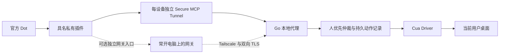

# DotControl

目标是让官方 Dot 操作你指定的 Windows 或 Mac。DotControl 通过私有 MCP 插件、每设备独立 Secure MCP Tunnel 和本地代理提供执行能力；可选在自己的常开电脑上汇总设备。官方 Dot 的桌面任务接入仍受产品执行入口和电脑授权限制，隧道不能替代这些前提。没有另建聊天助手，也不复制 Dot 的记忆或登录状态。

**当前是 0.1.0 开发预览。** 已从真正的官方 Dot 通过私有插件和 Secure MCP Tunnel 返回 Windows 设备信息，并对专用窗口完成观察、后台点击与相同请求去重；本机独立核对计数为 1。Windows 本地中文输入与文件保存另有实测记录。

**2026-10-12 已通过真正的 Windows → Mac 核心场景：** 官方 Dot 保持连接 Windows，由 Windows 本地任务通过 DotControl Mac 后台计算 6×8=48。五条回执均为 succeeded/background/verified，独立回读一致；最终截图已通过原生附件返回，并在官方 Dot 对话实际显示。结束时 Windows 仍为 attached 电脑，Mac attached=false，全程未创建或继续 Mac 本地任务。详见 [跨电脑验收](docs/CROSS_DEVICE_ACCEPTANCE.md)。

**同日 Mac → Windows 的核心计算与截图交付也已完成：** 官方 Dot 保持连接 Mac，由 Mac 本地任务经 Windows 插件计算 4×9=36，结束时 Windows attached=false。五条回执独立回读为三条 succeeded/background/verified、两条 unknown/background/execution_uncertain；最终图片已在官方 Dot 实际显示，本会话目视确认结果 36。这证明反向核心场景完成，不代表五步回执全部通过；清除和乘号的 unknown 原样保留，未重复点击。见 [反向跨电脑记录](docs/validation/mac-to-windows-2026-10-12.json)。

此前 Mac 本地任务的 7×8=56、历史 unknown 回执与图片交付阻塞继续保留，不能用新结果改写旧记录。双向核心场景均有实际结果和可见截图；多应用、物理接管、真实双机网关、持续稳定性和自动安装仍待完成，详见 [验收记录](docs/validation/ACCEPTANCE.md)。



## 快速开始

前提：Windows 11 x64，或 macOS 14+；已登录的用户会话；Go 1.25+（本轮使用 1.27.2）；官方账号可添加私有 MCP 插件且有隧道权限。Mac 需要 Xcode Command Line Tools。安装脚本固定第三方版本与校验值，不需要管理员运行。

Windows，在本项目目录的 PowerShell 中：

```powershell
./scripts/Install-Windows.ps1 -DeviceName '办公室 Windows'
& "$env:LOCALAPPDATA/DotControl/bin/dotcontrol.exe" doctor
& "$env:LOCALAPPDATA/DotControl/bin/dotcontrol.exe" serve --no-tunnel
```

Mac，在本项目目录：

```sh
bash scripts/install-macos.sh 'MacBook'
"$HOME/Library/Application Support/DotControl/bin/dotcontrol" doctor
"$HOME/Library/Application Support/DotControl/bin/dotcontrol" serve --no-tunnel
```

无法通过 SSH 安装时，可使用包含双架构代理和桌面驱动的 Mac 本地包；不需要 Go 的首轮诊断步骤见 [Mac 本机开始验收](docs/MAC_START_HERE.md)。

这先启动本机代理。按 [安装与官方连接](docs/INSTALL.md) 创建每台设备自己的隧道、录入运行凭据并添加具名插件，然后移除 `--no-tunnel`。凭据通过隐藏输入保存到 Windows 凭据管理器或 macOS 钥匙串，不写入配置文件。安装不会自动授予系统权限或设置开机启动。

## 使用方式

向官方 Dot 指定具名插件和目标，例如：“使用 DotControl 办公室 Windows，先报告设备名和校验值，然后观察 DotControl 测试窗口，输入中文并保存，核对结果。”先完成 [真实验收步骤](docs/validation/ACCEPTANCE.md) 再操作个人工作资料。

- `status`：当前连接、活动和暂停状态。
- `pause` / `resume`：暂停或恢复接收动作。恢复需要新的观察。
- `revoke`：暂停、停止本机隧道并轮换本地 MCP 凭据；同时到 Platform 撤销云端运行凭据、移除插件。
- `doctor --online`：检查本机前提及官方隧道连接；不宣称 Dot 已调用成功。
- `pair`：配对、查询和撤销可选网关设备，见 [网关说明](docs/GATEWAY.md)。

每次操作必须绑定设备、任务、动作和观察编号。失去响应的动作返回 `unknown`，先重新观察，不能换编号盲目重试。`succeeded` 是单步效果的证据；最终任务还要核对界面或产出文件。

## 支持边界

默认连续 60 秒没有输入才允许前台操作。有人使用时仅尝试执行器明确支持的后台操作，并避开用户正在使用的应用。活动状态未知或锁屏时拒绝动作。前台拖动暂时拒绝，避免不能及时释放的长手势。后台能力依赖系统和应用，无法保证所有操作都不打扰用户。

观察保存于内存，30 秒过期、一次性使用；默认不把截图、输入正文或可访问性树写入动作日志。日志仅保存编号、状态、时间和带密钥的摘要。原生驱动收到动作之后不能保证立即撤销；取消会阻止后续输入，已发出的部分可能需要人工核对。Mac 文本输入及系统活动监控的保守限制见 [架构决策](docs/ARCHITECTURE.md)。

Cua Driver 自身可能启用不包含内容的使用统计；这不等于 DotControl 记录输入正文。请同时检查所安装驱动的隐私设置和上游说明。此项目尚未经过独立安全审计。

## 开发与复现

```sh
go test ./...
go test -race ./...
go vet ./...
go build -trimpath -o dist/dotcontrol ./cmd/dotcontrol
```

Windows 的可复现真实桌面演示见 [演示说明](demos/README.md)，测试窗口只处理指定的临时输出文件。`dotcontrol mcp` 是本地 stdio 调试入口，不能替代官方 Dot 验收。公开接口与错误语义见 [协议](docs/PROTOCOL.md)。

[依赖锁定](dependencies.lock.json) · [第三方许可证](THIRD_PARTY_NOTICES.md) · [实施状态](docs/IMPLEMENTATION.md)

MIT License。DotControl 为独立项目，与 OpenAI、Cua、Tailscale 没有官方隶属关系。
